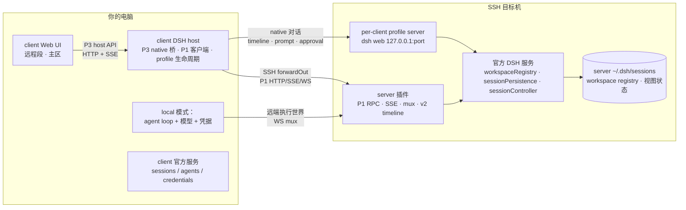

# dsh-remote-workspace

[English](README.md) | 中文

[](LICENSE)
[](package.json)
[](#compatibility)
[](https://www.npmjs.com/package/dsh-remote-workspace)

把一台 SSH 主机打开成 DeepSeek Harness 工作区。**server 是一台能独立工作的普通 DSH；本插件让它成为
client 的远程入口。** 工作区、会话、会话日志与共享视图状态都以 server 为权威；client 用两段式侧栏
展示它们，并为每个会话选择执行端：

- **local 模式**（默认）：agent loop 与模型凭据在 client；文件、进程、沙箱、终端与会话日志仍在 server。
  server 一般没有配置模型 key，所以新连接默认走本机执行。
- **server 模式**（可选）：agent loop、模型请求、凭据与工具执行都在 server；client 主区用 timeline/SSE
  自绘 native 对话。仅当 server 已配置模型凭据时使用。

两种模式写同一份 server 会话日志，所以切换执行端不是切换会话。

## Screenshots


侧栏保持两段：**远程工作区**（连接 → server 工作区 → server 会话）与本机**工作区**。server 行复用
官方行组件；连接行与会话行显示当前执行端；搜索只过滤当前 client 视图，不落盘。

## Why this exists

Harness 只在自己运行的机器上干活。当工作必须发生在别处——构建机、GPU 主机、预发服务器——有三种做法：

1. **把文件复制回来。** 镜像会漂移、冲突，两个人碰同一棵树就会悄悄出问题。
2. **所有东西都跑在远端。** 模型凭据和对话也跟着搬过去，换台电脑就没法接着干。
3. **server 保持普通 DSH，client 做它的远程入口。** 这就是本插件：目标机上跑 per-client profile
   server（`dsh web`），client 通过 SSH 访问它，server 官方数据保持权威。

由此得到三条不变量：

- **凭据不过线。** server 模式用 server 的模型凭据，local 模式用 client 的；SSH 密钥只在 client。
  错误、日志与流式明细都会脱敏。
- **目标机不监听公网端口。** profile server 只绑 `127.0.0.1`，client 经 SSH `forwardOut` 访问。
- **每 client 一个 profile，每会话一个写者。** server 插件持有 client lease；官方 JSONL flock 跨进程
  裁决会话写者，第二个写者会得到明确的 `session/writer-held`，而不是静默写坏日志。

如果你只需要“在一台服务器上改文件”，官方 SSH profile（`dsh-ssh` + `fs-ssh` + `subprocess-ssh` +
`sandbox-ssh`）更小，也不需要装插件。

## How it compares

| | 官方 SSH profile | 文件路由类插件 | 本插件 |
| --- | --- | --- | --- |
| 工具在哪执行 | 远端 | 远端 | 远端 |
| 一个界面里多个 target | 每台一个 profile | 支持 | 支持 |
| 会话日志权威 | 本地 | 本地 | **server** |
| 工作区/pin/archive/顺序 | 本地 | 本地 | **server（跨 client 共享）** |
| 每会话执行端 | 固定本机 | 固定本机 | **server 或 client** |
| 换台电脑继续 | 不行 | 不行 | **可以** |

## Architecture



client host 负责 SSH、host key pin、runtime/插件部署、per-client profile 生命周期、P3 native 桥与
P1 客户端；server 插件负责握手/租约、官方服务包装的 workspace/session API、registry 写守卫/刷新、
local 模式 persist 桥、执行世界 WS mux 与 v2 timeline/event/prompt 适配。portal/embed 只保留为 v1
回退，不再由 native server 主区挂载。逐字契约见
[doc/refactor-v1-architecture.md](doc/refactor-v1-architecture.md) 与
[doc/refactor-v1-protocol.md](doc/refactor-v1-protocol.md)。

## Feature breakdown

**server 模式——client 自绘对话，server 权威。** client 主区自己渲染对话，不再嵌入 profile UI。
历史通过 `session/timeline` 读取 server 官方 JSONL；assistant/tool/approval 实时事件经 host SSE 桥
传输；prompt、cancel、approval 发给 server 端 managed agent。visual 层尽量复用官方 DSH 组件
（`MarkdownText`、`TerminalBlock`、`ReadBlock`、`SearchBlock`、`DiffBlock`、`CodeBlock`、`JsonBlock`、
按钮/tooltip/StateDot）；官方 conversation shell 未导出，header/timeline/composer 薄壳由插件自写。
server 模式不再有 iframe，也不依赖 server 官方 UI DOM。

**local 模式——client agent、server 执行世界。** client routing 把私有本地 anchor 映射到 server
会话路径；执行世界是 WebSocket mux 的 `fs`/`subprocess`/`sandbox`/`terminal`。会话日志仍写入 server
官方 JSONL 存储，client 本地不保存副本。

**server 权威的侧栏。** workspace 清单/标题/顺序/pin/archive 来自 server 官方
`workspaceRegistry`；session 清单/标题/blank/running 来自 `sessionController` + 插件 JSONL title fold。
rename/fork/pin/archive/拖拽都调官方服务。搜索仅 client 内存过滤。

**per-client profile 与 runtime。** 每个 client 生成稳定 `clientId`，server 上用
`graydovee-remote-workspace-<clientId>`。专用 profile 与 server 插件从 client 包内置的
`dsh-remote-workspace-server-<version>.tgz` 离线安装；独立 Node+DSH runtime 自动安装/升级（或只读复用
已验证的全局 DSH）。profile lease 拒绝第二个驱动实例。

**Host key 必须确认。** 首次连接展示 host key SHA-256 并等待显式确认；之后 key 变化会中止连接。

**沙箱与权限。** server profile 挂官方 sandbox provider/policy；没有隔离 backend 时明确返回 partial
enforcement 并在 server 执行，不假装已隔离。local 模式在执行世界不可用时 fail-closed，绝不回退到
client 本地文件系统。

## Quick start

装进 client 的 `web` profile（Plugins 页面或 CLI）：

```bash
dsh plugin --profile web add dsh-remote-workspace
```

pnpm 可能拦截 `ssh2` 的可选 native 构建脚本；用 Plugins 页面安装，或首次运行加
`--config.strict-dep-builds=false`。已安装但未启用时，在 Plugins 页面启用（或把
`dsh-remote-workspace` 加进 `~/.dsh/profiles/web/package.json` 的 `dsh.profile.bundles`）。重启服务
`dsh web` 的进程并刷新页面。

从 checkout 构建安装：

```bash
pnpm install && pnpm typecheck && pnpm test && pnpm build
pnpm pack --pack-destination ~/.dsh/tarballs
dsh plugin --profile web add ~/.dsh/tarballs/dsh-remote-workspace-<version>.tgz
```

client 包内置 server 插件 tarball，因此目标机不需要网络或包管理器。然后：

1. 在侧栏 **远程工作区** 点 **新建连接**。
2. 选择 `SSH`，填目标信息，首次连接确认 host key 指纹。
3. 查看探测结果。client 检查 server 的 Node/DSH 运行时与 server 插件，决定后续步骤是部署、更新还是跳过；
   随后启动 profile server 并完成握手鉴权。失败的尝试不会保存。
4. 在连接行点加号，浏览目标机目录并添加为 server 工作区。
5. 点工作区下的空白行新建会话，或点已有行继续。连接行的执行端开关切换 server/local（默认 local）。

## Execution end and session ownership

- 连接有默认执行端；每个会话记录创建时的执行端，直到显式切换。
- 切换当前会话会先取消它的运行中 turn；已产生内容保留，会话 id 与历史不变，下一轮使用新执行端，
  仍写同一份 server 日志。
- **D20：** 如果 profile 还有其它 active turn，切换对话框会列出并要求显式确认后才一起取消，绝不静默
  打断其它会话。
- 同一会话只能有一个写者。server 模式由官方 UI 打开/resume 并持有官方 JSONL 锁；local 模式由插件的
  executor 记录 + 同一把锁保证。第二个实例打开同一会话会得到 `session/writer-held`。
- 断开连接会停止 per-client profile server、关闭隧道并取消该 profile 的 turn；server 日志、工作区与
  共享视图状态不受影响。

## Compatibility

当前只对这一个运行时做过验证：

| 插件 | 已验证 DSH 运行时 | 状态 |
| --- | --- | --- |
| 0.1.0-alpha.3 | 0.2.1-rc.3 | verified |
<!-- verified-runtimes -->

本版本针对 DSH `0.2.1-rc.3` 构建、打包并测试；`0.2.1-rc.2` 已不在已验证集合内，默认会被精确版本
守卫拒绝，除非显式豁免该组合。检查项、剩余范围与升级步骤见
[doc/dsh-rc3-compatibility.md](doc/dsh-rc3-compatibility.md)。

声明是**精确版本**，不是区间：清单把 `engines.dsh` 与全部 `@deepseek-ai/dsh-*` peer 钉在上面的运行时，
客户端也只在 server 版本属于已验证运行时时才接受它。DSH 还是开发者预览版；未验证版本会被一条可操作的
错误拒绝，而不是跑到一半失败。

如果确实要在本机试别的 DSH 版本，对这一对精确版本做豁免，并把结果视为不受支持：

```bash
dsh plugin --profile web allow-version dsh-remote-workspace@<已安装版本> \
  --dsh-version <运行时版本> --accept-risk
```

豁免只覆盖本机宿主；server 必须运行已验证运行时——client 安装的独立 runtime，或复用该精确版本的全局 DSH。

独立 runtime 会优先复用 `~/.dsh/remote-assets/` 中该平台/版本的缓存包；缓存没有时，client 用本机 pnpm
按同一 `node/` + `dsh/` 布局构建并上传，因此升级 DSH 后首次连接可能慢一些，之后直接复用。构建只写入
专用 profile 的独立 runtime，不改 server 的全局 DSH 或其它 profile。

## Data and security

| 位置 | 内容 |
| --- | --- |
| client `~/.dsh/storages/dsh_remote_workspace.json` | 连接记录、包策略、旧 workspace refs（会清理） |
| client `~/.dsh/.credentials.yaml` | SSH 凭据（官方存储，`0600`） |
| client `~/.dsh/remote-workspaces/<clientId>/…` | local 模式会话的私有 anchor（非权威） |
| client `~/.dsh/remote-assets/` | 本机 runtime/包缓存 |
| server `~/.dsh/sessions/**` | 权威会话日志（两种模式共用） |
| server `~/.dsh/storages/workspace.json` | 权威 workspace registry、pin/archive/顺序 |
| server `~/.dsh/profiles/graydovee-remote-workspace-<clientId>/` | 专用 profile、server 插件、lease、日志 |
| server `~/.dsh/remote-workspace/<clientId>/runtime/` | 独立 Node/DSH runtime |
| server `~/.dsh/remote-server-sessions/**`（旧） | 保留、不展示、不迁移 |

模型 API key 与 SSH 凭据不会跨端：server 模式用 server 模型凭据，local 模式用 client 的；SSH 凭据只
在 client。profile server 的启动 token 与官方 cookie 只在 client host 内存，浏览器永远拿不到。每个插件
HTTP 路由都做同源/可信主机校验并限制 body 大小；错误、日志与流式明细经过脱敏。凭据文件本身由 DSH
凭据存储写入。

## Known limitations

- **D19：多 client 是刷新/重连后一致，不是实时推送。** 两个 client 共享 server 的 workspace/session/
  视图状态，但另一个 client（或 server 全局 DSH）的改动要在刷新/重连后可见；server 全局 DSH 独立可用，
  client 的改动可能需要重启全局 DSH 才显示。
- **v1 全局 runtime 只复用、不修改。** client 会检测并只读复用已验证的全局 DSH；安装/升级共享全局
  runtime 或其它 profile 的插件会被拒绝并给出可操作错误；只有专用 per-client profile 与独立 runtime
  会自动安装。
- **local 模式仍在收尾。** 切换、打开会话与 server 日志桥已可用；远端执行世界（经 mux 的
  fs/process/terminal）是剩余工作。能力不可用时显示官方错误，绝不回退到 client 本地文件系统。
- **不删除会话。** 官方 DSH 没有该能力，本插件也不新增。
- **local 模式是默认执行端。** 新连接默认使用 client agent（新 server 通常没配模型 key）；配置 server
  凭据后再显式切到 server 模式。
- **native server 主区，不再用 iframe。** server 模式对话由 client 自绘 timeline 渲染；历史读 server
  JSONL，实时事件用 `afterSeq` 重连。portal/iframe 仅保留为 v1 回退，不再挂载。v2.0 不支持附件和
  server 模型选择器；composer 会明确禁用附件。
- **重启 profile 会取消它的所有 turn。** 普通刷新只重读数据；加载 workspace registry 变更用进程内官方
  service reload；完整重启 profile 是 fallback，且必须经过 D20 确认。
- **远程段是 client 插件 UI。** 需要 client 的 `web` profile；desktop/headless profile 不是本界面支持的 target。
- **server 世界是 POSIX。** SSH 目标需提供 POSIX shell；v1 已退役 WSL/Docker 连接方式（Docker 只用于 QA）。

## Troubleshooting

| 症状 | 检查 |
| --- | --- |
| `incompatible-version` | 本机装 DSH `0.2.1-rc.3`，或对该精确版本做豁免（见 Compatibility）。 |
| 没有「远程工作区」区域 | 插件必须已安装并在 `web` 启用；重启 `dsh web` 并刷新。 |
| `server-plugin-missing` / `server-plugin-version-mismatch` | client 包内置的 server 插件 tarball 丢失/版本不匹配；重装 client 插件后重连。 |
| `server-plugin-integrity-failed` | 内置/下载的 server 插件 sha256 校验失败；重装 client 包。 |
| `profile-in-use` / `profile-foreign-client` | 另一个 client 实例在驱动该 profile，或 clientId 被复制。用持有实例重试，或删除本机连接记录后重连。 |
| `registry-stale` | 另一个进程改了 server workspace registry。点远程段刷新；仍失败则按 D20 确认后重连（重启 profile）。 |
| `session/writer-held` | 该会话已被另一个实例驱动。等它结束，或刷新/重连；日志不会被写坏。 |
| `runtime-global-unsupported` / `plugin-profile-not-managed` | v1 不修改共享全局 runtime/其它 profile；使用专用 profile/独立 runtime。 |
| `mode-switch/cancel-failed` / `shutdown-flush-timeout` | 重启前有 turn 取消失败/未完成落盘；UI 会列出，等它们收尾后重试。 |
| SSH 在部署前失败 | 检查账号、密钥权限、agent 与指纹；`ssh -v <host>` 是好用的下一步。 |
| 命令提示没有可用的沙箱 backend | 目标机没有隔离 backend；这是文档化的 partial enforcement 路径。 |

## Development

[AGENTS.md](AGENTS.md) 是开发契约（v1 边界、逐字节共享文件、存储与安全不变量、发布流程）。架构与协议：
[doc/refactor-v1-architecture.md](doc/refactor-v1-architecture.md)、
[doc/refactor-v1-protocol.md](doc/refactor-v1-protocol.md)，UI 复用矩阵见
[doc/official-workspace-reuse.md](doc/official-workspace-reuse.md)。server 半边在
[dsh-remote-workspace-server](https://github.com/graydovee/dsh-remote-workspace-server)。

## License

MIT
