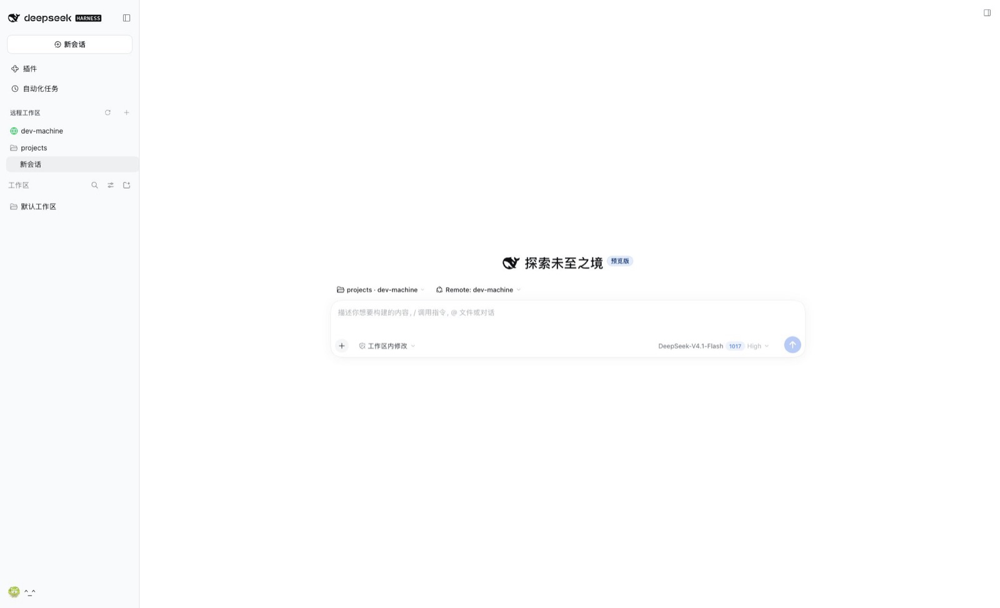
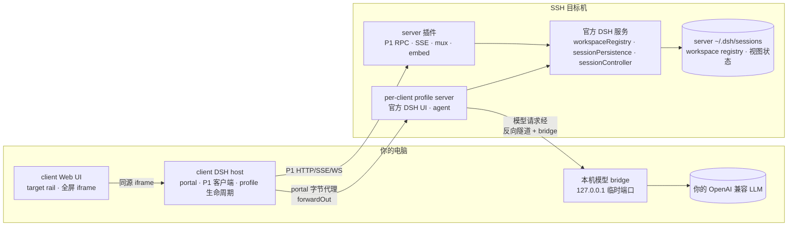

# dsh-remote-window

[English](README.md) | 中文

[](LICENSE)
[](package.json)
[](#compatibility)
[](https://www.npmjs.com/package/dsh-remote-window)

把一台 SSH 主机打开成 DeepSeek Harness 工作区。**server 是一台能独立工作的普通 DSH；本插件让它成为
client 的远程入口。** 工作区、会话、会话日志与共享视图状态都以 server 为权威。client 只加一条浮动
target rail，并把 server 的**完整官方 DSH UI 以同源 iframe 全屏铺满主区**——sidebar、header、对话、
右侧栏与第三方 UI 插件都是 server 上跑的那一份；client 不再自绘对话。

连接时选择 agent 的**模型请求**由谁服务：

- **local（默认）**：agent、会话日志与工具仍在 server，但每次模型请求经 SSH 反向隧道转发到 client
  本机。默认接入方式是 **自动代理本机模型**：client 用本机 DSH 的 `ctx.llm` 枚举全部 provider/model，
  无需填 endpoint 或 key，每个 provider 在 server profile 的模型选择器里各成一条 route。**全部
  provider/model 一律转发**，没有勾选 UI；server 会话直接在本机全部模型之间切换。本机暂时没有可用
  模型时也能连接：此时不启动反向隧道，profile 用 server 自己已配的模型，之后本机新增的模型在下次
  连接时自动同步。新 server 通常没配模型 key，所以默认走这里；本机模型目录读取异常时用带 code 的
  错误提示，绝不静默回退到 server 模型。
- **server（可选）**：server profile 使用自己的模型配置；仅当 server 已配置模型凭据时显式选择。

两种来源写同一份 server 会话日志；切换模型来源需要重连，而不是换会话。

## Screenshots



client 只保留一个远程面：浮动 **target rail**（默认收起，hover 或 `Alt+R` 展开），列已保存连接、实时
阶段与连接/切换/忘记动作。target rail 可拖到任意屏幕边缘并自动吸附：收起时跟随吸附边（左右为 44px 竖排图标条、
上下为 44px 横排图标条），**展开后无论哪条边都是同一个 280px 竖向列表**（按视口限高、列表纵向滚动），
位置跨刷新记忆。连接数大于 1 时，收起条末端多一个折叠按钮（竖排在最后一个图标下方、横排在图标条右端，
箭头指向收起方向）；按钮在同一张卡片里、但不属于 hover 展开组，指针移上去不会把条带展开。点击把 rail
最小化为单个 `+N` 图标（N 为连接数），此时 hover 不展开；再点图标直接一步展开（指针移开后回到收起条）。连接后，
server 自己的 sidebar
与对话就是导航；iframe 挂载期间 client shell sidebar 隐藏。

## Why this exists

Harness 只在自己运行的机器上干活。当工作必须发生在别处——构建机、GPU 主机、预发服务器——有三种做法：

1. **把文件复制回来。** 镜像会漂移、冲突，两个人碰同一棵树就会悄悄出问题。
2. **所有东西都跑在远端。** 模型凭据和对话也跟着搬过去，换台电脑就没法接着干。
3. **server 保持普通 DSH，client 做它的远程入口。** 这就是本插件：目标机上跑 per-client profile
   server（`dsh web`），client 通过 SSH 访问它，server 官方数据保持权威。

由此得到三条不变量：

- **凭据不过线。** server 模型来源用 server 自己的凭据；local 来源的 key 只存 client 凭据库，由 bridge
  注入。SSH 密钥只在 client。错误、日志与流式明细都会脱敏。
- **目标机不监听公网端口。** profile server 只绑 `127.0.0.1`，client 经 SSH `forwardOut` 访问。
- **每 client 一个 profile，每会话一个写者。** server 插件持有 client lease；官方 JSONL flock 跨进程
  裁决会话写者，第二个写者会得到明确的 `session/writer-held`，而不是静默写坏日志。

如果你只需要“在一台服务器上改文件”，官方 SSH profile（`dsh-ssh` + `fs-ssh` + `subprocess-ssh` +
`sandbox-ssh`）更小，也不需要装插件。

## How it compares

| | 官方 SSH profile | 文件路由类插件 | 本插件 |
| --- | --- | --- | --- |
| 工具在哪执行 | 远端 | 远端 | 远端 |
| 一个界面里多个 target | 每台一个 profile | 支持 | 支持 |
| 会话日志权威 | 本地 | 本地 | **server** |
| 工作区/pin/archive/顺序 | 本地 | 本地 | **server（跨 client 共享）** |
| 连接的模型来源 | 固定本机 | 固定本机 | **local 隧道或 server** |
| 换台电脑继续 | 不行 | 不行 | **可以** |

## Architecture



client host 负责 SSH、host key pin、runtime/插件部署、per-client profile 生命周期、P1 客户端、同源
portal 与本机模型 bridge/tunnel。server 插件负责握手/租约、包装官方服务的 workspace/session API、
registry 写守卫、执行世界 WS mux 与 embed bootstrap/CSS。`dshRwFull=1` 让 embed 不再注入隐藏 sidebar/
rightbar/bottom 的 CSS，因此 iframe 里就是真实的 server UI。逐字契约见
[doc/refactor-v3-full-ui.md](doc/refactor-v3-full-ui.md)、
[doc/refactor-v1-architecture.md](doc/refactor-v1-architecture.md) 与
[doc/refactor-v1-protocol.md](doc/refactor-v1-protocol.md)。

## Feature breakdown

**官方 UI 全屏 iframe。** client main slot 只挂一个同源 iframe，加载 profile server 的官方 `dsh web`
UI，请求带 `dshRwFull=1`。portal 剥掉 client GUI cookie、注入 profile 自己的 cookie、不转发
`Set-Cookie`，且 token 不进入 iframe URL。iframe sandbox 固定为
`allow-scripts allow-same-origin allow-forms allow-popups allow-downloads`。iframe 挂载期间 client
shell sidebar 隐藏，target rail 保留可用。

**local 模型来源。** server profile 的 `cordis.patch.yml` 声明若干官方 `llm-pi-ai` route，指向
`http://127.0.0.1:<随机>/<provider>/v1`。该端口是 SSH `forwardIn` 反向隧道，终止在 client 的
loopback-only bridge。默认的 **自动代理** 用本机 DSH 自己的 `ctx.llm` 枚举 provider/model
（`listProviders`/`listModels`），每个模型请求都以官方类型转成 `ctx.llm.stream()`，因此本机 DSH 的
凭据与协议原样生效、无需重填。本机发现到的**全部** provider/model 都会代理，没有过滤或勾选；本机
一个模型都没有时仍然可以连接（不启动桥/隧道，profile 继续用 server 自己的模型），下次连接会重新
发现并同步新模型。（旧的 **手动 endpoint** 路径仅为兼容旧设置/测试保留，对话框不再提供；profile
始终只看到占位 key。）本机目录读取异常、桥启动失败或 sshd 拒绝转发都返回带 code 的可操作错误，绝不
静默回退 server 模型。

**server 权威数据。** workspace 清单/标题/顺序/pin/archive 来自 server 官方
`workspaceRegistry`；session 清单/标题/blank/running 来自 `sessionController` + 插件 JSONL title fold。
rename/fork/pin/archive/拖拽都调官方服务。搜索仅 client 内存过滤。

**per-client profile 与 runtime。** 每个 client 生成稳定 `clientId`，server 上用
`graydovee-remote-window-<clientId>`。专用 profile 与 server 插件从 client 包内置的
`dsh-remote-window-server-<version>.tgz` 离线安装；独立 Node+DSH runtime 自动安装/升级（或只读复用
已验证的全局 DSH）。profile lease 拒绝第二个驱动实例。

**Host key 必须确认。** 首次连接展示 host key SHA-256 并等待显式确认；之后 key 变化会中止连接。

**沙箱与权限。** server profile 为 iframe 里的 agent 挂官方 sandbox provider/policy；没有隔离 backend
时明确返回 partial enforcement 并在 server 执行，不假装已隔离。v2 executor 的远端执行世界仍保留在
代码/数据中供旧会话使用，但新主区不再进入。

## Quick start

装进 client 的 `web` profile（Plugins 页面或 CLI）：

```bash
dsh plugin --profile web add dsh-remote-window@alpha
```

目前发布的版本都是 npm `alpha` 通道上的预发布；`latest` 可能滞后（仍指向 `0.1.0-alpha.3`，它的 DSH
区间更旧），所以不要用裸包名，需要可复现时写 Compatibility 表里的精确版本。也可以下载 GitHub Release
的预构建 tarball（在 Plugins 页面填它的绝对路径），或直接从 Git 分支安装——使用仓库里已提交的
`lib/`，不在本机跑构建：

```bash
dsh plugin --profile web add github:graydovee/dsh-remote-window
```

旧 tag 仍声明 `prepare`，所以不要按 tag 安装（`#v0.1.0-alpha.5` 会报
`ERR_PNPM_GIT_DEP_PREPARE_NOT_ALLOWED`）。

pnpm 可能拦截 `ssh2` 的可选 native 构建脚本；用 Plugins 页面安装，或首次运行加
`--config.strict-dep-builds=false`。已安装但未启用时，在 Plugins 页面启用（或把
`dsh-remote-window` 加进 `~/.dsh/profiles/web/package.json` 的 `dsh.profile.bundles`）。重启服务
`dsh web` 的进程并刷新页面。

从 checkout 构建安装：

```bash
pnpm install && pnpm typecheck && pnpm test && pnpm build
pnpm pack --pack-destination ~/.dsh/tarballs
dsh plugin --profile web add ~/.dsh/tarballs/dsh-remote-window-<version>.tgz
```

client 包内置 server 插件 tarball，因此目标机不需要网络或包管理器。然后：

1. 打开浮动 **target rail**（hover 或按 `Alt+R`），点 **新建连接**。
2. 选择 `SSH`，填目标信息，首次连接确认 host key 指纹。
3. 选择模型来源：**local**（默认）或 **server**（使用 server profile 自己的模型配置）。选 **local**
   时，本机 DSH 的全部 provider/model 都会转发给 server profile（没有勾选步骤）；本机还没有模型也能
   连接，之后新增的模型会在下次连接时同步。
4. 查看探测结果。client 检查 server 的 Node/DSH 运行时与 server 插件，决定后续步骤是部署、更新还是
   跳过；随后启动 profile server，选 local 模型时打开 SSH 反向隧道，并完成握手鉴权。失败的尝试不会
   保存。
5. 成功后该 target 自动激活，server 官方 DSH UI 在 iframe 中全屏打开。用 server 自己的 sidebar
   建工作区、开会话；切换 target、重载 iframe、忘记连接都在 rail 上完成。

## Model source and session ownership

- 模型来源是连接设置，不是会话内热切换：更改它要按 D20 cancel → `whenIdle`/flush 后重启 profile。
  对话、会话 id 与日志不变。
- local 模型来源下，本机每个 provider 在 profile 里各成一条 `remote-<provider>` route，全部由同一条
  sshd 反向隧道与同一个 client bridge 服务。断开或异常退出会关闭 bridge、隧道、profile 及其进程，不
  留下孤儿端口；重连会复用已保存的 `DSH_HOME`，profile patch 与隧道留在同一目录。
- **D20：** 如果 profile 还有 active turn，重启/切换对话框会列出它们并要求显式确认后才一起取消，绝不
  静默打断会话。
- 同一会话只能有一个写者。iframe 里的官方 UI 打开/resume 会话并持有官方 JSONL 锁；第二个实例打开
  同一会话会得到 `session/writer-held`。
- 断开连接会停止 per-client profile server、关闭 portal/隧道并取消该 profile 的 turn；server 日志、
  工作区与共享视图状态不受影响。

## Compatibility

兼容性是**声明出来的区间**，不是藏在代码里的常量：

<!-- verified-runtimes:start -->
| Plugin | Supported DSH | Published runtimes |
| --- | --- | --- |
| 0.1.0-alpha.3 | = 0.2.1-rc.3 | 0.2.1-rc.3 |
| 0.1.0-alpha.4 | >= 0.2.1-rc.2 <= 0.2.1-rc.5 | 0.2.1-rc.5, 0.2.1-rc.3 |
| 0.1.0-alpha.5 | >= 0.2.1-rc.2 <= 0.2.1-rc.5 | 0.2.1-rc.5, 0.2.1-rc.3 |
<!-- verified-runtimes:end -->

这张表由 `node scripts/sync-compat.mjs` 从 [`compat/runtimes.json`](compat/runtimes.json) 生成；
`--check` 会在清单、peer、README 与生成表不一致时让发布失败。三个版本号各有含义，故意分开：

- **插件版本**（`0.1.0-alpha.4`）是我们自己的包版本，按我们的节奏走。
- **DSH 区间**（`min … max`，两端闭）表示这个构建能驱动的 DSH 版本。DSH 是开发者预览版，高于上界的
  版本和低于下界的版本一样可能不兼容，所以判断是闭区间，而不是「这个版本或更新」。区间退化为单版本时
  就直接写成精确版本。
- **runtime 产物**（`dsh-runtime-<dsh>-<平台>.tar.gz`）按它内含的 DSH 版本命名，而不是插件版本：包里是
  `node/` 加 `@deepseek-ai/dsh@<dsh>`，不含插件代码，多个插件版本复用同一份产物。

连接时会自动挑「能拿到 runtime 的最新受支持 DSH」：显式 `DSH_RW_RUNTIME_ARTIFACT` → 区间内且健康的
全局 DSH → 本地缓存 → 已发布的 release 产物 → POSIX 宿主本地构建。版本在区间内但暂时没有产物时会明确
报「没有可用 runtime 产物」，不会被当成不兼容。`engines.dsh` 与全部 `@deepseek-ai/dsh-*` peer 使用同一
表达式：区间为单版本时写精确版本，否则写 `>=min <=max`。

远端的 server 可以是 Linux、macOS 或 **Windows**。Windows 目标需要预置
`dsh-runtime-<version>-win32-<arch>.tar.gz`（`DSH_RW_RUNTIME_ARTIFACT`，或放在
`~/.dsh/remote-assets/` 的同名文件），或复用一份健康的全局 DSH——client 目前不会自行下载 runtime 产物。
Windows 契约、失败码与真机验证记录见 [doc/windows-server-support.md](doc/windows-server-support.md)。

独立 runtime 会优先复用 `~/.dsh/remote-assets/` 中该平台/版本的缓存包；缓存没有时，client 用本机 pnpm
按同一 `node/` + `dsh/` 布局构建并上传，因此升级 DSH 后首次连接可能慢一些，之后直接复用。构建只写入
专用 profile 的独立 runtime，不改 server 的全局 DSH 或其它 profile。

## Data and security

| 位置 | 内容 |
| --- | --- |
| client `~/.dsh/storages/dsh_remote_window.json` | 连接记录（含模型来源）、本机模型 endpoint/模型/超时、包策略、旧 workspace refs（会清理） |
| client `~/.dsh/.credentials.yaml` | SSH 凭据与本机模型 API key（官方存储，`0600`） |
| client `~/.dsh/remote-windows/<clientId>/…` | v2 local 会话的私有 anchor（保留，非权威，不再展示） |
| client `~/.dsh/remote-assets/` | 本机 runtime/包缓存 |
| server `~/.dsh/sessions/**` | 权威会话日志（两种模型来源共用） |
| server `~/.dsh/storages/workspace.json` | 权威 workspace registry、pin/archive/顺序 |
| server `~/.dsh/profiles/graydovee-remote-window-<clientId>/` | 专用 profile、server 插件、lease、日志 |
| server `~/.dsh/remote-window/<clientId>/runtime/` | 独立 Node/DSH runtime |
| server `~/.dsh/remote-server-sessions/**`（旧） | 保留、不展示、不迁移 |

本机模型 API key 不会到 server 或浏览器：它只存 client 官方凭据库，只由 loopback bridge 读取并注入
转发的请求；server profile 只看到占位 `DSH_RW_LOCAL_LLM_KEY`。SSH 凭据也只在 client。profile server
的启动 token 与官方 cookie 只在 client host 内存，浏览器永远拿不到；portal 剥掉 client cookie，且不
转发 `Set-Cookie`。每个插件 HTTP 路由都做同源/可信主机校验并限制 body 大小；错误、日志与流式明细经过
脱敏。凭据文件本身由 DSH 凭据存储写入。

## Known limitations

- **D19：多 client 是刷新/重连后一致，不是实时推送。** 两个 client 共享 server 的 workspace/session/
  视图状态，但另一个 client（或 server 全局 DSH）的改动要在刷新/重连后可见；server 全局 DSH 独立可用，
  client 的改动可能需要重启全局 DSH 才显示。
- **v1 全局 runtime 只复用、不修改。** client 会检测并只读复用已验证的全局 DSH；安装/升级共享全局
  runtime 或其它 profile 的插件会被拒绝并给出可操作错误；只有专用 per-client profile 与独立 runtime
  会自动安装。
- **不删除会话。** 官方 DSH 没有该能力，本插件也不新增。
- **local 模型来源是默认。** 新连接默认走 client bridge（新 server 通常没配模型 key）；默认子模式自动
  代理本机 DSH 的全部模型目录，不需要手填。配置 server 凭据后再显式选 server 模型来源；更改来源需要
  重连。
- **v2 executor（远端执行世界）不再被主区使用。** iframe 始终驱动 server agent。记录过 v2 `local`
  executor 的旧会话留在数据里，但新 UI 不再进入；详见
  [doc/refactor-v3-full-ui.md](doc/refactor-v3-full-ui.md)。
- **每个 client 只挂一个 iframe。** 打开第二个远程 target 会替换 frame（前一个 target 断开或在 rail
  中保持非激活）。没有两个 server 的分屏。
- **旧的手动本机 endpoint 只支持 HTTP（`/v1/*`）。** 它仅为旧设置保留、对话框不再提供，TLS 从未
  实现。自动代理模式没有这个问题（走本机 DSH 自己的 provider 客户端）。
- **sshd 必须允许反向转发。** 若 `AllowTcpForwarding`/`GatewayPorts` 策略拒绝 `forwardIn`，连接会以
  可操作错误失败，绝不静默改用 server 模型。
- **重启 profile 会取消它的所有 turn。** 普通刷新只重读数据；加载 workspace registry 变更用进程内官方
  service reload；完整重启 profile 是 fallback，且必须经过 D20 确认。
- **target rail 是 client 插件 UI。** 需要 client 的 `web` profile；desktop/headless profile 不是本界面支持的 target。
- **server 世界是 POSIX。** SSH 目标需提供 POSIX shell；v1 已退役 WSL/Docker 连接方式（Docker 只用于 QA）。

## Troubleshooting

| 症状 | 检查 |
| --- | --- |
| `incompatible-version` | 本机装区间内的 DSH（`0.2.1-rc.2 … 0.2.1-rc.5`），或对该精确版本做豁免（见 Compatibility）。 |
| `ERR_PNPM_GIT_DEP_PREPARE_NOT_ALLOWED` | 安装的提交里声明了构建脚本（`prepare`），而 profile 的 `allowBuilds` 没有放行。改用 `dsh-remote-window@alpha`、Release tarball，或包含打包修复的提交；旧 tag 仍带该脚本。 |
| 没有 target rail | 插件必须已安装并在 `web` 启用；重启 `dsh web` 并刷新。hover rail 或按 `Alt+R` 展开。 |
| `server-plugin-missing` / `server-plugin-version-mismatch` | client 包内置的 server 插件 tarball 丢失/版本不匹配；重装 client 插件后重连。 |
| `server-plugin-integrity-failed` | 内置/下载的 server 插件 sha256 校验失败；重装 client 包。 |
| `profile-in-use` / `profile-foreign-client` | 另一个 client 实例在驱动该 profile，或 clientId 被复制。用持有实例重试，或删除本机连接记录后重连。 |
| `registry-stale` | 另一个进程改了 server workspace registry。点远程段刷新；仍失败则按 D20 确认后重连（重启 profile）。 |
| `session/writer-held` | 该会话已被另一个实例驱动。等它结束，或刷新/重连；日志不会被写坏。 |
| `runtime-global-unsupported` / `plugin-profile-not-managed` | v1 不修改共享全局 runtime/其它 profile；使用专用 profile/独立 runtime。 |
| `local-llm-*`（如 `local-llm-providers-unavailable`、`local-llm-no-models`、`local-llm-unreachable`、`local-llm-tunnel-failed`） | 先确认本机 DSH 配了可用模型；在高级选项点「刷新」重读目录；再查 server sshd 的反向转发策略。修好后重试，或改选 server 模型来源。 |
| 连接对话框看起来卡住 | 对话框有逐步状态、`已用 Ns` 计时和等待提示；单个长步骤（例如隔离 runtime 部署 Node）会一直显示「进行中」，直到该步结束才更新文案。若 host 不可达会出现轮询告警，而不是静默卡住。 |
| `mode-switch/cancel-failed` / `shutdown-flush-timeout` | 重启前有 turn 取消失败/未完成落盘；UI 会列出，等它们收尾后重试。 |
| SSH 在部署前失败 | 检查账号、密钥权限、agent 与指纹；`ssh -v <host>` 是好用的下一步。 |
| 命令提示没有可用的沙箱 backend | 目标机没有隔离 backend；这是文档化的 partial enforcement 路径。 |

## Development

[AGENTS.md](AGENTS.md) 是开发契约（v3 边界、逐字节共享文件、存储与安全不变量、发布流程）。当前主区与
模型来源契约见 [doc/refactor-v3-full-ui.md](doc/refactor-v3-full-ui.md)；协议仍见
[doc/refactor-v1-architecture.md](doc/refactor-v1-architecture.md) 与
[doc/refactor-v1-protocol.md](doc/refactor-v1-protocol.md)。server 半边在
[dsh-remote-window-server](https://github.com/graydovee/dsh-remote-window-server)。

## License

MIT
