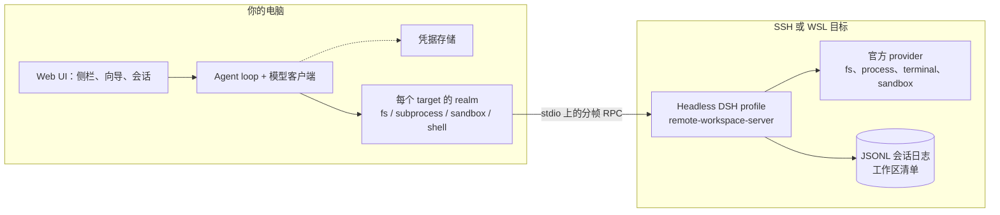

# dsh-remote-workspace

[English](README.md) | 中文

[](LICENSE)
[](package.json)
[](#compatibility)
[](https://www.npmjs.com/package/dsh-remote-workspace)

把一台 SSH 主机打开成 DeepSeek Harness 的工作区。agent loop、模型请求和凭据留在你的电脑上，
文件、命令与会话日志留在远端机器上，因此换一台电脑可以接着同一个工作区干，不需要复制会话目录。

## Screenshots


侧栏区域按「连接 → 工作区 → 会话」分组，输入区显示远端预设与工作区级权限模式。这个界面里没有
本机路径——会话与日志都在目标机上。

## Why this exists

Harness 只在自己运行的机器上干活。当工作必须发生在别处——构建机、GPU 主机、预发服务器——只有三种
做法，而只有第三种不会把会话弄丢：

1. **把文件复制回来。** 镜像会漂移、会冲突，两个人碰同一棵树就会悄悄出问题。
2. **把 agent 跑在远端。** 那模型凭据和对话也跟着搬过去，每台机器都要装一套。
3. **agent 留在本机，世界放在远端。** 这就是本插件的做法：目标机上跑一个 headless DSH profile，
   本机通过 SSH（或 WSL）stdio 上的一条分帧 RPC 协议与它对话。

由此得到三条不变量，代码的形状就是被它们决定的：

- **凭据不过线。** 模型 key 与 SSH 密钥留在本机凭据存储；错误、日志与流式明细在显示前都会脱敏。
- **目标机不监听任何端口。** 没有端口要暴露：server 半边就是 SSH 通道 stdio 上的一个子进程。
- **每个 target 只有一个 server 进程。** 浏览与 agent 操作共用一条通道，这是"单写者、单工作区清单"
  能成立的原因。

如果你只需要"在一台服务器上改文件"，到这里就够了，请直接用官方 SSH profile（`dsh-ssh` + `fs-ssh` +
`subprocess-ssh` + `sandbox-ssh`）：它更小，也不需要装插件。

## How it compares

| | 官方 SSH profile | 文件路由类插件 | 本插件 |
| --- | --- | --- | --- |
| 工具在哪执行 | 远端 | 远端 | 远端 |
| 一个界面里多个 target | 每台一个 profile | 支持 | 支持 |
| 会话日志 | 本地 | 本地 | **远端，以 server 为权威** |
| 沙箱 | 远端 provider | 宿主侧策略 | **远端 provider + 策略** |
| 换台电脑继续 | 不行 | 不行 | **可以** |

真正的分界不是"是否远端执行"——三列都是远端。分界是**会话日志与工作区清单是否以目标机为权威**，
这才是多客户端、跨天工作能对上的前提。

## Architecture



本机半边拥有 agent loop、模型、凭据和浏览器界面；远端半边拥有文件、进程、沙箱 backend 与权威会话日志。
每个 target 一个独立 realm，两个 target 不会意外共用一个会话世界；realm 挂不上时会话会拒绝运行，而不是
静默退回本机执行。协议细节见 [doc/architecture.md](doc/architecture.md) 与
[doc/api-contract.md](doc/api-contract.md)。

## Feature breakdown

**远端执行世界。** 通过一个 `ctx.ssh` 适配器把 DSH 自己的文件、进程、终端与沙箱 provider 指向目标机。
因此 `read` / `write` / `edit` / `glob` / `grep` 与 `bash` 直接作用在远端目录上，没有镜像，也没有需要
额外学的专用工具。

**会话以 server 为权威。** 新建、打开、续聊、重命名、分叉、置顶、归档都读写目标机上的 JSONL 日志。
重命名只追加一条 `session/title` 事件、不打开会话；分叉走 shell 自己的分叉并保留继承事件元数据；
置顶与归档只保存本机视图状态，不改写日志。

**三种运行时来源。** 先只读探测目标机，然后可以*复用*已安装且版本已验证的 `dsh`、*上传*在本机为目标
OS/CPU 构建的包，或*下载*对应架构的已发布包并在上传前校验 checksum。每个 target 只启动一个 server 进程。

**主机指纹固定。** 首次连接显示 host key 的 SHA-256 并等待显式确认；之后指纹变化会中止连接。
WSL 是本机进程，没有 host key 确认步骤。

**沙箱与权限。** 远端 profile 挂载官方 sandbox provider 与 policy，有 backend 时写入被限制在工作区根内。
客户端要的是事实而不是假设：目标机没有隔离 backend 时，世界会报告 partial enforcement，并在远端执行命令。

**WSL。** Windows 上同一个插件可以把 WSL 发行版当作 target。发行版驱动的是 POSIX 世界（多行脚本走
`/bin/sh -s`），且不需要 host key 确认。

**多客户端共用一个工作区。** 清单与日志都在远端，因此第二台电脑连到同一 target 时看到同样的工作区，
并能接着同一个会话。

## Quick start

装进 `web` profile。最省事的是侧栏 **插件 → 添加插件**：在那里安装 `dsh-remote-workspace` 会连同
bundle 一起启用。

在终端里装也可以，但 `dsh plugin add` 只装文件、不选中 bundle，装完要在插件页把它启用（或把它加进
`~/.dsh/profiles/web/package.json` 的 `dsh.profile.bundles`）：

```bash
dsh plugin --profile web add dsh-remote-workspace
# 然后到「插件」页启用 dsh-remote-workspace，或手工加进 dsh.profile.bundles
```

或者从源码构建后装 tarball，步骤相同：

```bash
pnpm install && pnpm typecheck && pnpm test && pnpm build
pnpm pack --pack-destination ~/.dsh/tarballs
dsh plugin --profile web add ~/.dsh/tarballs/dsh-remote-workspace-<version>.tgz
```

插件把运行时真正 import / 挂载的四个官方 SSH provider 包（`dsh-ssh`、`dsh-fs-ssh`、
`dsh-subprocess-ssh`、`dsh-sandbox-ssh`）作为普通依赖一起安装——harness 自身不带这几个包，所以干净
安装也能直接加载。重启服务 `dsh web` 的进程并刷新页面。然后：

1. 在侧栏打开 **远程工作区**，点 **新建连接**。
2. 选择 `SSH`（Windows 上也可选 `WSL`），填别名与目标信息，首次连接时确认 host key 指纹。
3. 向导会自动连接并探测目标机；然后从扫描到的列表里选一个已安装的 dsh 复用，或选「部署新运行时」
   再决定上传 / 远程下载。连接失败不会保存 —— 只有成功之后才会出现这条连接。
4. 在连接行上点加号，浏览目标机目录并添加为工作区。
5. 工作区下面的空白行用于新会话，已有行用于继续会话。

此后 agent 就在远端树里工作：`bash` 在那边跑，文件在那边读写，会话日志也写在那边。

## Compatibility

当前只对这一个运行时做过验证：

| 插件 | 已验证 DSH 运行时 | 状态 |
| --- | --- | --- |
| 0.1.0-alpha.3 | 0.2.1-rc.2 | verified |
<!-- verified-runtimes -->

声明是**精确版本**，不是区间：清单把 `engines.dsh` 与全部 `@deepseek-ai/dsh-*` peer 钉在上面的运行时，
客户端也只在远端 launcher 版本属于已验证运行时时才接受它。DSH 还是开发者预览版，未验证的版本不承诺能用——
它会被一条可操作的错误拒绝，而不是跑到一半失败。

如果你确实要试别的 DSH 版本，在 profile 里对这一对精确版本做豁免，并把结果视为不受支持：

```bash
dsh plugin --profile web allow-version dsh-remote-workspace@<已安装版本> \
  --dsh-version <运行时版本> --accept-risk
```

该豁免只覆盖本机宿主上的插件。远端 launcher 是别的版本时无法豁免：在目标机装已验证的运行时，或选择
*上传* / *下载* 让客户端把它部署上去。运行时包目前覆盖 `linux-x64-gnu`、`linux-arm64-gnu`、`darwin-x64`、
`darwin-arm64`；Windows 宿主通过 WSL 进入 POSIX 世界。

## Data and security

| 位置 | 内容 |
| --- | --- |
| 目标机 `~/.dsh/remote-server-sessions/` | 权威会话日志 |
| 目标机 `~/.dsh/remote-server/` | server 身份、工作区清单与状态清单 |
| 目标机 `~/.dsh/server/` | 上传的 Node/DSH 运行时与部署的 server bundle |
| 本机 DSH 存储 | 目标记录、工作区引用、置顶/归档视图状态 |
| 本机 `~/.dsh/remote-assets/` | 已校验的 Node 与 server 包缓存 |

模型 API key 与 SSH 凭据只留在本机：浏览器拿不到 secret，错误、日志与流式明细都经过脱敏。HTTP 路由
做过同源与可信主机校验并限制 body 大小。凭据文件本身由 DSH 凭据存储写入（`~/.dsh/.credentials.yaml`，
权限 `0600`），本插件只引用其中的记录。

## Known limitations

- **版本耦合是有意设计。** 每个发布对应一个已验证运行时；扩窗是一次以部署为背书、走发布的动作，而不是改区间。
- **暂时没有端口转发与终端面板。** 远端进程通过 `bash` 访问；没有到远端 dev server 的本机转发，也没有交互式终端页签。
- **远端世界是 POSIX。** 不支持原生 Windows 目标；Windows 通过 WSL 进入。
- **只支持 web profile。** desktop profile 不提供本包使用的浏览器模块表与 SSH 依赖。
- **`desktop`/`headless` profile** 不是这个界面支持的 target。

## Troubleshooting

| 症状 | 检查 |
| --- | --- |
| `incompatible-version` | 在本机 `web` profile 装 DSH `0.2.1-rc.2`，或对该精确版本做豁免（见 Compatibility）。 |
| 没有「远程工作区」区域 | 插件必须装在 `web`；重启 `dsh web` 并刷新页面。 |
| 复用的启动器被拒 | 目标机的 `dsh` 不是已验证运行时——在那边装，或改用上传/下载。 |
| 首屏显示没有工作区 | 等 server 清单加载完再点刷新。 |
| SSH 在部署前失败 | 检查账号、密钥权限、agent 与指纹；`ssh -v <host>` 是好用的下一步。 |
| `unsupported remote session protocol` | 重连，让客户端重新部署匹配的 server bundle。 |
| 命令提示没有可用的沙箱 backend | 目标机没有隔离 backend，这是文档化的 partial enforcement 路径。 |

## Development

[AGENTS.md](AGENTS.md) 是开发契约：跨仓库逐字节同步文件、本地命令、存储与安全不变量、发布流程。
路线图与背后的决策见 [doc/milestone.md](doc/milestone.md)。server 半边在
[dsh-remote-workspace-server](https://github.com/graydovee/dsh-remote-workspace-server)。

## License

MIT
