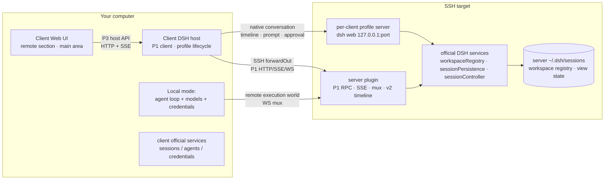

# dsh-remote-workspace

English | [中文](README-zh.md)

[](LICENSE)
[](package.json)
[](#compatibility)
[](https://www.npmjs.com/package/dsh-remote-workspace)

Open an SSH host as a DeepSeek Harness workspace. **The server is an ordinary DSH that can work on its
own; this plugin makes it your remote entry.** Workspaces, sessions, session logs and shared view state
stay authoritative on the server; the client shows them in its two-section sidebar and chooses where each
session executes:

- **Local mode** (default): the agent loop and model credentials run on your computer, while files,
  processes, sandbox, terminal and the session log stay on the server. Fresh servers usually have no
  model key, so a new connection starts here. The client's main area renders the conversation natively from the server timeline/SSE APIs,
  using official DSH visual components; it no longer embeds the server UI in an iframe.
- **Server mode** (optional): the agent loop, model calls, credentials and tool execution all run on the
  server. The client's main area renders the conversation natively from the server timeline/SSE APIs.
  Use this only when the server already has model credentials configured.

Both modes write the same server-side session log, so switching execution is not switching sessions.

## Screenshots


The sidebar keeps two sections: **Remote Workspaces** (connection → server workspace → server session) and
the client's own local **Workspaces**. Server rows reuse the official row components. A badge on the
connection and session rows shows the current execution end; searching filters only the current client
view and is never persisted.

## Why this exists

Harness works on the machine that runs it. When the work has to happen somewhere else — a build box, a
GPU host, a staging server — there are three options:

1. **Copy the files back.** A mirror drifts, conflicts, and quietly breaks the moment two people touch
   the same tree.
2. **Run everything on the remote.** Then the model credentials and the conversation live there too, and
   another computer cannot join without copying a session directory.
3. **Keep the server as a normal DSH and make the client its remote entry.** That is this plugin: one
   per-client profile server runs `dsh web` on the target, the client reaches it over SSH, and the
   server's official data stays authoritative.

Three invariants follow:

- **Credentials never cross the line.** Server mode uses the server's model credentials; local mode uses
  the client's. SSH secrets stay on the client. Errors, logs and streamed details are scrubbed.
- **The target listens on nothing public.** The profile server binds `127.0.0.1` only and is reached
  through an SSH `forwardOut` tunnel.
- **One profile per client, one writer per session.** The server plugin holds a client lease; the
  official JSONL flock arbitrates session writes across processes, and a second writer gets an explicit
  `session/writer-held` error instead of silently corrupting the log.

If you only need "edit files on one server", the official SSH profile (`dsh-ssh` + `fs-ssh` +
`subprocess-ssh` + `sandbox-ssh`) is smaller and needs no plugin.

## How it compares

| | Official SSH profile | File-routing plugins | This plugin |
| --- | --- | --- | --- |
| Where tools execute | remote | remote | remote |
| Several targets in one UI | one profile per host | yes | yes |
| Session log authority | local | local | **server** |
| Workspace / pin / archive / order | local | local | **server (shared by clients)** |
| Execution end per session | fixed local | fixed local | **server or client** |
| Continuation from another computer | no | no | **yes** |

## Architecture



The client host owns SSH, host-key pinning, runtime/plugin deployment, the per-client profile lifecycle,
the P1 client and the P3 native-conversation bridge. The server plugin owns the handshake and lease,
workspace and session APIs backed by official services, the registry write guard/refresh, the local-mode
persist bridge, the execution-world WebSocket mux and the v2 timeline/event/prompt adapter. The portal and
embed bootstrap remain only as a v1 fallback and are not mounted by the native server main. The detailed
contracts are in
[doc/refactor-v1-architecture.md](doc/refactor-v1-architecture.md) and
[doc/refactor-v1-protocol.md](doc/refactor-v1-protocol.md).

## Feature breakdown

**Server mode — native client conversation, server authority.** The client main area renders the
conversation itself instead of embedding the profile UI. History comes from the server's official JSONL
through `session/timeline`; live assistant/tool/approval events flow over the host SSE bridge; prompts,
cancel and approvals go to the server-side managed agent. The client reuses official DSH visual
components (`MarkdownText`, `TerminalBlock`, `ReadBlock`, `SearchBlock`, `DiffBlock`, `CodeBlock`,
`JsonBlock`, buttons, tooltips and state dots) over that adapter; the official conversation shell is not
exported, so the thin header/timeline/composer shell is plugin-owned. There is no server-mode iframe or
server UI DOM dependency.

**Local mode — client agent, server world.** The client routing layer maps a private local anchor to the
server session path; the execution world is a WebSocket mux `fs`/`subprocess`/`sandbox`/`terminal`.
The session log is still written to the server's official JSONL store, and the client's local storage
never receives a copy. The model's working directory is the real remote path, and the execution host is
identified by `<user>@<host>:<port>`; DSH-internal anchors and connection mechanics are not exposed to
the model.

**Server-authoritative sidebar.** Workspace list/title/order/pin/archive come from the server's official
`workspaceRegistry`; session list/title/blank/running come from `sessionController` plus a plugin-side
JSONL title fold. Rename, fork, pin, archive and drag reorder call the official services. Search is a
client-only, in-memory filter.

**Per-client profile and runtime.** Each client generates a stable `clientId` and uses
`graydovee-remote-workspace-<clientId>` on the server. The dedicated profile and its server plugin are
installed offline from the client package's bundled `dsh-remote-workspace-server-<version>.tgz`; the
isolated Node + DSH runtime is installed/upgraded automatically (or a verified global DSH is reused
read-only). A profile lease rejects a second driver for the same profile.

**Host keys are pinned.** The first connection shows the host key's SHA-256 and waits for explicit
confirmation; a later key change stops the connection.

**Sandbox and permissions.** The server profile mounts the official sandbox provider and policy; when no
confinement backend exists, the world reports partial enforcement and runs there explicitly instead of
pretending. Local mode fails closed if the remote execution world is unavailable — it never falls back to
the client filesystem.

## Quick start

Install into the client `web` profile, from the **Plugins** page or the CLI:

```bash
dsh plugin --profile web add dsh-remote-workspace
```

pnpm may refuse `ssh2`'s optional native build script; let the Plugins page install it or pass
`--config.strict-dep-builds=false` on the first run. If it is already installed but not enabled, enable it
on the Plugins page (or add `dsh-remote-workspace` to `dsh.profile.bundles` in
`~/.dsh/profiles/web/package.json`). Restart the process that serves `dsh web` and reload the page.

From a checkout:

```bash
pnpm install && pnpm typecheck && pnpm test && pnpm build
pnpm pack --pack-destination ~/.dsh/tarballs
dsh plugin --profile web add ~/.dsh/tarballs/dsh-remote-workspace-<version>.tgz
```

The package ships the server plugin tarball it needs, so the target does not need network access or a
package manager. Then:

1. Open **Remote Workspaces** in the sidebar and choose **New connection**.
2. Choose `SSH`, fill in the target, and confirm the host-key fingerprint on first contact.
3. Review the probe result. The client checks the server's Node/DSH runtime and server plugin, then decides
   whether the next steps deploy, update, or skip; it then starts the profile server and authenticates its
   handshake. A failed attempt is not saved.
4. Use the plus action on the connection row to browse the target and add a directory as a server
   workspace.
5. Open the blank row under a workspace for a new session, or an existing row to continue one. The
   connection row's mode control switches the execution end (local by default).

## Execution end and session ownership

- A connection has a default execution end; each session records the end it was created with and keeps it
  until you switch explicitly.
- Switching the current session cancels its running turn first; produced content is kept, the session id
  and history do not change, and the next turn uses the new end. It writes the same server log.
- **D20:** if the profile still has other active turns, the switch dialog lists them and requires explicit
  confirmation before canceling them. It never silently interrupts other sessions.
- A session can have only one writer. In server mode the official UI opens/resumes the session and holds
  the official JSONL lock; in local mode the plugin's executor record and the same lock enforce it.
  Opening the same session from a second instance surfaces `session/writer-held`.
- Disconnecting stops the per-client profile server, closes the tunnel and cancels the profile's turns;
  server-side logs, workspaces and shared view state are untouched.

## Compatibility

Verified against exactly this runtime:

| Plugin | Verified DSH runtime | Status |
| --- | --- | --- |
| 0.1.0-alpha.3 | 0.2.1-rc.3 | verified |
<!-- verified-runtimes -->

This release is built, packed and tested against DSH `0.2.1-rc.3`. `0.2.1-rc.2` is no longer in the
verified set, so the exact-version guard refuses it unless you explicitly exempt that pair. See
[doc/dsh-rc3-compatibility.md](doc/dsh-rc3-compatibility.md) for what was checked, what remains, and the
upgrade procedure.

The declaration is a **precise version**, not a range: the manifest pins `engines.dsh` and every
`@deepseek-ai/dsh-*` peer to the runtime above, and the client accepts the server only when its version is
one of the verified runtimes. DSH is a developer preview; an unverified release is refused with an
actionable message instead of failing halfway.

If you intentionally run another DSH version locally, exempt the exact pair and treat the result as
unsupported:

```bash
dsh plugin --profile web allow-version dsh-remote-workspace@<installed version> \
  --dsh-version <runtime version> --accept-risk
```

That exemption covers the local host only. The server side must run the verified runtime — either the
isolated runtime the client installs, or a global DSH reusing that exact verified version.

The isolated runtime reuses a platform/version cache under `~/.dsh/remote-assets/` first. When the cache is
missing, the client builds the same `node/` + `dsh/` layout with the host pnpm and uploads it, so the first
connection after a DSH upgrade can be slower; later connections reuse it. The build only populates the
dedicated profile's isolated runtime and never modifies the server's global DSH or another profile.

## Data and security

| Location | Contents |
| --- | --- |
| Client `~/.dsh/storages/dsh_remote_workspace.json` | Connection records, package policy, legacy workspace refs (cleaned up) |
| Client `~/.dsh/.credentials.yaml` | SSH credentials (official store, mode `0600`) |
| Client `~/.dsh/remote-workspaces/<clientId>/…` | Private anchors for local-mode sessions (non-authoritative) |
| Client `~/.dsh/remote-assets/` | Local runtime/package cache |
| Server `~/.dsh/sessions/**` | Authoritative session logs (both modes) |
| Server `~/.dsh/storages/workspace.json` | Authoritative workspace registry, pin/archive/order |
| Server `~/.dsh/profiles/graydovee-remote-workspace-<clientId>/` | Dedicated profile, server plugin, lease, logs |
| Server `~/.dsh/remote-workspace/<clientId>/runtime/` | Isolated Node/DSH runtime |
| Server `~/.dsh/remote-server-sessions/**` (legacy) | Retained but not shown and not migrated |

Model API keys and SSH credentials never cross to the other end: server mode uses the server's model
credentials, local mode the client's; SSH credentials stay on the client. The profile server's launch
token and official cookie live only in the client host's memory — the browser never receives them. Every
plugin HTTP route is same-origin/trusted-host checked with a body size limit; errors, logs and streamed
details pass through a scrubber. The credential file itself is written by DSH's credential store.

## Known limitations

- **D19: multi-client consistency is refresh/reconnect consistency, not real-time push.** Two clients
  share the server's workspaces/sessions/view state, but a change made by another client (or by the
  server's own global DSH) becomes visible after refresh/reconnect. The server's global DSH keeps working
  independently; changes made by clients may need a restart of that global DSH to show up there.
- **Global runtime is reuse-only in v1.** The client detects and reuses a verified global DSH, but
  installing/upgrading the shared global runtime or another profile's plugin is refused with an
  actionable error; only the dedicated per-client profile and its isolated runtime are installed
  automatically.
- **Local mode is still hardening.** Switching, opening sessions and the server-log bridge work; the
  remote execution world (fs/process/terminal through the mux) is the remaining area being completed.
  When a capability is unavailable, the client shows the official error and never falls back to the
  client filesystem.
- **No session deletion.** The official DSH has no such action, so this plugin does not add one.
- **Local mode is the default.** A new connection starts with the client agent because a fresh server
  usually has no model key; switch to server mode explicitly after configuring server credentials.
- **Native server main, no iframe.** Server-mode conversations render in the client’s native timeline
  panel; history is read from the server JSONL and live events reconnect with `afterSeq`. The portal/iframe
  path is a v1 fallback and is not mounted. v2.0 has no attachments or server model picker; the composer
  disables attachments explicitly.
- **Restarting a profile cancels all of its turns.** Refresh normally only re-reads data;
  loading a changed workspace registry uses the in-process official-service reload; a full profile
  restart is the fallback and requires the D20 confirmation.
- **The sidebar's remote section is client-plugin UI.** It needs the `web` profile of the client; the
  desktop/headless profiles are not supported targets for the UI.
- **POSIX server world.** SSH targets must provide a POSIX shell; WSL/Docker connection methods are retired
  in v1 (Docker is used only by QA).

## Troubleshooting

| Symptom | What to check |
| --- | --- |
| `incompatible-version` | Install DSH `0.2.1-rc.3` locally, or exempt that exact pair (see Compatibility). |
| No Remote Workspaces section | The plugin must be installed and enabled in `web`; restart `dsh web` and reload. |
| `server-plugin-missing` / `server-plugin-version-mismatch` | The client package lost or mismatched its bundled server-plugin tarball; reinstall the client plugin and reconnect. |
| `server-plugin-integrity-failed` | The bundled/downloaded server plugin failed its sha256 check; reinstall the client package. |
| `profile-in-use` / `profile-foreign-client` | Another client instance drives this profile, or the clientId was copied. Retry with the owning instance, or remove this client's connection record and reconnect. |
| `registry-stale` | Another process changed the server workspace registry. Run the remote section's Refresh; if it still fails, reconnect (profile restart) after the D20 confirmation. |
| `session/writer-held` | The session is already being driven by another instance. Wait for it to finish, or refresh/reconnect; the log is not corrupted. |
| `runtime-global-unsupported` / `plugin-profile-not-managed` | v1 does not modify the shared global runtime or other profiles; use the dedicated profile/isolated runtime. |
| `mode-switch/cancel-failed` / `shutdown-flush-timeout` | Some turns could not be canceled/flushed before a restart. The UI shows which ones; retry after they settle. |
| SSH fails before deployment | Check the account, key permissions, agent and fingerprint; `ssh -v <host>` is a good next step. |
| A command reports no usable sandbox backend | The target has no confinement backend; the partial-enforcement path is expected and visible. |

## Development

[AGENTS.md](AGENTS.md) holds the development contract (v1 boundaries, byte-identical files, storage and
security invariants, release procedure). Architecture and wire contracts:
[doc/refactor-v1-architecture.md](doc/refactor-v1-architecture.md),
[doc/refactor-v1-protocol.md](doc/refactor-v1-protocol.md), and the UI reuse matrix in
[doc/official-workspace-reuse.md](doc/official-workspace-reuse.md). The server half lives in
[dsh-remote-workspace-server](https://github.com/graydovee/dsh-remote-workspace-server).

## License

MIT
