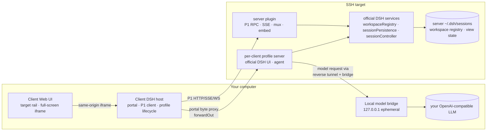

# dsh-remote-workspace

English | [中文](README-zh.md)

[](LICENSE)
[](package.json)
[](#compatibility)
[](https://www.npmjs.com/package/dsh-remote-workspace)

Open an SSH host as a DeepSeek Harness workspace. **The server is an ordinary DSH that can work on its
own; this plugin makes it your remote entry.** Workspaces, sessions, session logs and shared view state
stay authoritative on the server. The client adds a floating target rail and shows the server's
**complete official DSH UI in a full-screen same-origin iframe** — sidebar, header, conversation, right
sidebar and third-party UI plugins are exactly what the server runs. The client no longer redraws the
conversation.

The connection chooses where the agent's **model requests** are served:

- **Local model** (default): the agent, session log and tools stay on the server, but every model request
  is forwarded over an SSH reverse tunnel to your machine. By default the client **auto-proxies every
  provider and model your local DSH already has** (`ctx.llm` catalog) — no endpoint or API key to enter;
  each provider becomes its own route in the server profile's model picker. Under **advanced options**
  the whole discovered catalog is listed with checkboxes (all selected by default); the choice is saved
  and decides which routes the profile gets, so the server session can freely switch between the models
  you allow. Fresh servers usually have no model key, so this is the default; an unreadable catalog
  blocks the connection instead of silently falling back to server models.
- **Server model** (optional): the server profile uses its own model configuration. Choose this
  explicitly when the server already has model credentials.

Both sources write the same server-side session log; switching the model source requires a reconnect, not
a new session.

## Screenshots


The client keeps exactly one remote surface: a floating **target rail** (collapsed by default, hover or
`Alt+R` to expand) listing saved connections, their live phase and the connect/switch/forget actions. Drag
the rail to any screen edge: it snaps to left/right as a compact column (280px when expanded) or to
top/bottom as a horizontal bar whose expanded row grows with the target count (overflow scrolls), and
remembers that dock across reloads. Once connected, the server's own
sidebar and conversation are the navigation; the client shell sidebar hides while the iframe is mounted.

## Why this exists

Harness works on the machine that runs it. When the work has to happen somewhere else — a build box, a
GPU host, a staging server — there are three options:

1. **Copy the files back.** A mirror drifts, conflicts, and quietly breaks the moment two people touch
   the same tree.
2. **Run everything on the remote.** Then the model credentials and the conversation live there too, and
   another computer cannot join without copying a session directory.
3. **Keep the server as a normal DSH and make the client its remote entry.** That is this plugin: one
   per-client profile server runs `dsh web` on the target, the client reaches it over SSH, and the
   server's official data stays authoritative.

Three invariants follow:

- **Credentials never cross the line.** With the server model source the profile uses the server's own
  credentials; with the local model source the key stays in the client's credential store and only the
  bridge injects it. SSH secrets stay on the client. Errors, logs and streamed details are scrubbed.
- **The target listens on nothing public.** The profile server binds `127.0.0.1` only and is reached
  through an SSH `forwardOut` tunnel.
- **One profile per client, one writer per session.** The server plugin holds a client lease; the
  official JSONL flock arbitrates session writes across processes, and a second writer gets an explicit
  `session/writer-held` error instead of silently corrupting the log.

If you only need "edit files on one server", the official SSH profile (`dsh-ssh` + `fs-ssh` +
`subprocess-ssh` + `sandbox-ssh`) is smaller and needs no plugin.

## How it compares

| | Official SSH profile | File-routing plugins | This plugin |
| --- | --- | --- | --- |
| Where tools execute | remote | remote | remote |
| Several targets in one UI | one profile per host | yes | yes |
| Session log authority | local | local | **server** |
| Workspace / pin / archive / order | local | local | **server (shared by clients)** |
| Model source per connection | fixed local | fixed local | **local bridge or server** |
| Continuation from another computer | no | no | **yes** |

## Architecture



The client host owns SSH, host-key pinning, runtime/plugin deployment, the per-client profile lifecycle,
the P1 client, the same-origin portal and the local-model bridge/tunnel. The server plugin owns the
handshake and lease, workspace and session APIs backed by official services, the registry write guard,
the execution-world WebSocket mux and the embed bootstrap/CSS. `dshRwFull=1` makes the embed leave the
official sidebar/rightbar/bottom in place, so the iframe is the real server UI. The detailed contracts are
in [doc/refactor-v3-full-ui.md](doc/refactor-v3-full-ui.md),
[doc/refactor-v1-architecture.md](doc/refactor-v1-architecture.md) and
[doc/refactor-v1-protocol.md](doc/refactor-v1-protocol.md).

## Feature breakdown

**Full-screen official UI.** The client main slot hosts one same-origin iframe of the profile server's
official `dsh web` UI, requested with `dshRwFull=1`. The portal strips the client GUI cookie, injects the
profile's own cookie, never forwards `Set-Cookie`, and keeps the profile token out of the iframe URL. The
iframe uses a minimal sandbox (`allow-scripts allow-same-origin allow-forms allow-popups allow-downloads`).
The client shell sidebar hides while the frame is mounted; the target rail stays available.

**Local model source.** The server profile's `cordis.patch.yml` declares official `llm-pi-ai` routes
that point at `http://127.0.0.1:<random>/<provider>/v1`. That port is an SSH `forwardIn` reverse
tunnel, terminated by a loopback-only bridge on the client. The default **auto proxy** enumerates the
local DSH's own `ctx.llm` providers/models (`listProviders`/`listModels`) and answers every model call
from `ctx.llm.stream()` with the harness' native types, so the local DSH's own credentials and protocols
keep working and nothing is re-entered. The client's **advanced options** persist which providers/models
are proxied (`localSelection`): unset means “all”, a filtered set trims the generated routes, and an
empty result is rejected. (The legacy manual endpoint path still exists for old saved settings and tests,
but the UI no longer offers it; the profile always sees a placeholder key.) An unreadable catalog, an
empty model list or an sshd that refuses forwarding is a coded, actionable failure — never a silent
fallback to server models.

**Server-authoritative data.** Workspace list/title/order/pin/archive come from the server's official
`workspaceRegistry`; session list/title/blank/running come from `sessionController` plus a plugin-side
JSONL title fold. Rename, fork, pin, archive and drag reorder call the official services. Search is a
client-only, in-memory filter.

**Per-client profile and runtime.** Each client generates a stable `clientId` and uses
`graydovee-remote-workspace-<clientId>` on the server. The dedicated profile and its server plugin are
installed offline from the client package's bundled `dsh-remote-workspace-server-<version>.tgz`; the
isolated Node + DSH runtime is installed/upgraded automatically (or a verified global DSH is reused
read-only). A profile lease rejects a second driver for the same profile.

**Host keys are pinned.** The first connection shows the host key's SHA-256 and waits for explicit
confirmation; a later key change stops the connection.

**Sandbox and permissions.** The server profile mounts the official sandbox provider and policy for the
agent running in the iframe; when no confinement backend exists it reports partial enforcement and runs
there explicitly instead of pretending. The v2 executor's remote execution world remains in code and data
for old sessions but is no longer reachable from the main area.

## Quick start

Install into the client `web` profile, from the **Plugins** page or the CLI:

```bash
dsh plugin --profile web add dsh-remote-workspace
```

pnpm may refuse `ssh2`'s optional native build script; let the Plugins page install it or pass
`--config.strict-dep-builds=false` on the first run. If it is already installed but not enabled, enable it
on the Plugins page (or add `dsh-remote-workspace` to `dsh.profile.bundles` in
`~/.dsh/profiles/web/package.json`). Restart the process that serves `dsh web` and reload the page.

From a checkout:

```bash
pnpm install && pnpm typecheck && pnpm test && pnpm build
pnpm pack --pack-destination ~/.dsh/tarballs
dsh plugin --profile web add ~/.dsh/tarballs/dsh-remote-workspace-<version>.tgz
```

The package ships the server plugin tarball it needs, so the target does not need network access or a
package manager. Then:

1. Open the floating **target rail** (hover it or press `Alt+R`) and choose **New connection**.
2. Choose `SSH`, fill in the target, and confirm the host-key fingerprint on first contact.
3. Choose the model source: **local** (default) or **server** (use the server profile's own model
   configuration). For **local**, **advanced options** lists every provider/model your local DSH has,
   all checked; untick what should not be exposed, refresh to re-discover, and the saved choice decides
   which models the server profile can switch between.
4. Review the probe result. The client checks the server's Node/DSH runtime and server plugin, then decides
   whether the next steps deploy, update, or skip; it starts the profile server, opens the SSH reverse
   tunnel when the local model source is selected, and authenticates the handshake. A failed attempt is
   not saved.
5. On success the target becomes active and the server's official DSH UI opens full-screen in the frame.
   Use the server sidebar to create workspaces and sessions. Switching targets, reloading the frame and
   forgetting a connection all happen from the rail.

## Model source and session ownership

- The model source is a connection setting, not a per-session switch: changing it restarts the profile
  (D20) after cancel → `whenIdle`/flush. The conversation, session id and log stay the same.
- With the local model source each discovered provider becomes a `remote-<provider>` route in the
  profile, all served by one sshd reverse tunnel and one client bridge. Stopping or losing the
  connection closes the bridge, the tunnel, the profile and its process; no orphan port is left behind.
  Reconnecting reuses the saved `DSH_HOME`, so the profile patch and the tunnel stay in the same place.
- **D20:** if the profile still has active turns, a restart/switch lists them and requires explicit
  confirmation before canceling them. It never silently interrupts sessions.
- A session has only one writer. The official UI in the iframe opens/resumes the session and holds the
  official JSONL lock; opening the same session from a second instance surfaces `session/writer-held`.
- Disconnecting stops the per-client profile server, closes the portal/tunnel and cancels the profile's
  turns; server-side logs, workspaces and shared view state are untouched.

## Compatibility

Verified against exactly this runtime:

| Plugin | Verified DSH runtime | Status |
| --- | --- | --- |
| 0.1.0-alpha.3 | 0.2.1-rc.3 | verified |
<!-- verified-runtimes -->

This release is built, packed and tested against DSH `0.2.1-rc.3`. `0.2.1-rc.2` is no longer in the
verified set, so the exact-version guard refuses it unless you explicitly exempt that pair. See
[doc/dsh-rc3-compatibility.md](doc/dsh-rc3-compatibility.md) for what was checked, what remains, and the
upgrade procedure.

The declaration is a **precise version**, not a range: the manifest pins `engines.dsh` and every
`@deepseek-ai/dsh-*` peer to the runtime above, and the client accepts the server only when its version is
one of the verified runtimes. DSH is a developer preview; an unverified release is refused with an
actionable message instead of failing halfway.

If you intentionally run another DSH version locally, exempt the exact pair and treat the result as
unsupported:

```bash
dsh plugin --profile web allow-version dsh-remote-workspace@<installed version> \
  --dsh-version <runtime version> --accept-risk
```

That exemption covers the local host only. The server side must run the verified runtime — either the
isolated runtime the client installs, or a global DSH reusing that exact verified version.

The isolated runtime reuses a platform/version cache under `~/.dsh/remote-assets/` first. When the cache is
missing, the client builds the same `node/` + `dsh/` layout with the host pnpm and uploads it, so the first
connection after a DSH upgrade can be slower; later connections reuse it. The build only populates the
dedicated profile's isolated runtime and never modifies the server's global DSH or another profile.

## Data and security

| Location | Contents |
| --- | --- |
| Client `~/.dsh/storages/dsh_remote_workspace.json` | Connection records (incl. model source), local-model endpoint/model/timeout, package policy, legacy workspace refs (cleaned up) |
| Client `~/.dsh/.credentials.yaml` | SSH credentials and the local-model API key (official store, mode `0600`) |
| Client `~/.dsh/remote-workspaces/<clientId>/…` | Private anchors for local-mode sessions (non-authoritative) |
| Client `~/.dsh/remote-assets/` | Local runtime/package cache |
| Server `~/.dsh/sessions/**` | Authoritative session logs (both model sources) |
| Server `~/.dsh/storages/workspace.json` | Authoritative workspace registry, pin/archive/order |
| Server `~/.dsh/profiles/graydovee-remote-workspace-<clientId>/` | Dedicated profile, server plugin, lease, logs |
| Server `~/.dsh/remote-workspace/<clientId>/runtime/` | Isolated Node/DSH runtime |
| Server `~/.dsh/remote-server-sessions/**` (legacy) | Retained but not shown and not migrated |

The local-model API key never reaches the server or the browser: it stays in the client's official
credential store, is read only by the loopback bridge, and is injected into the forwarded request. The
server profile only ever sees the placeholder `DSH_RW_LOCAL_LLM_KEY`. SSH credentials stay on the client
too. The profile server's launch token and official cookie live only in the client host's memory — the
browser never receives them, and the portal strips the client cookie while refusing to forward
`Set-Cookie`. Every plugin HTTP route is same-origin/trusted-host checked with a body size limit; errors,
logs and streamed details pass through a scrubber. The credential file itself is written by DSH's
credential store.

## Known limitations

- **D19: multi-client consistency is refresh/reconnect consistency, not real-time push.** Two clients
  share the server's workspaces/sessions/view state, but a change made by another client (or by the
  server's own global DSH) becomes visible after refresh/reconnect. The server's global DSH keeps working
  independently; changes made by clients may need a restart of that global DSH to show up there.
- **Global runtime is reuse-only in v1.** The client detects and reuses a verified global DSH, but
  installing/upgrading the shared global runtime or another profile's plugin is refused with an
  actionable error; only the dedicated per-client profile and its isolated runtime are installed
  automatically.
- **No session deletion.** The official DSH has no such action, so this plugin does not add one.
- **Local model source is the default.** A new connection starts with the client bridge because a fresh
  server usually has no model key; the default sub-mode auto-proxies the local DSH's whole catalogue, so
  there is nothing to type. Choose the server model source explicitly after configuring server
  credentials; changing it requires a reconnect.
- **The remote execution world (v2 executor) is no longer used by the main area.** The iframe always
  drives the server agent. Old sessions that recorded the v2 `local` executor are kept in data but are not
  reachable from the new UI; this is documented in [doc/refactor-v3-full-ui.md](doc/refactor-v3-full-ui.md).
- **One iframe per client.** Opening a second remote target swaps the frame (the previous target is
  disconnected or left in the rail as inactive). There is no split view of two servers.
- **Legacy manual local endpoint is HTTP-only (`/v1/*`).** It is kept for old saved settings only and is
  no longer part of the dialog; TLS to it was never implemented.
- **sshd must allow reverse forwarding.** If `AllowTcpForwarding`/`GatewayPorts` policy refuses
  `forwardIn`, the connection fails with an actionable error; it never silently uses the server model.
- **Restarting a profile cancels all of its turns.** Refresh normally only re-reads data;
  loading a changed workspace registry uses the in-process official-service reload; a full profile
  restart is the fallback and requires the D20 confirmation.
- **The target rail is client-plugin UI.** It needs the `web` profile of the client; the
  desktop/headless profiles are not supported targets for the UI.
- **POSIX server world.** SSH targets must provide a POSIX shell; WSL/Docker connection methods are retired
  in v1 (Docker is used only by QA).

## Troubleshooting

| Symptom | What to check |
| --- | --- |
| `incompatible-version` | Install DSH `0.2.1-rc.3` locally, or exempt that exact pair (see Compatibility). |
| No target rail | The plugin must be installed and enabled in `web`; restart `dsh web` and reload. Hover the rail or press `Alt+R`. |
| `server-plugin-missing` / `server-plugin-version-mismatch` | The client package lost or mismatched its bundled server-plugin tarball; reinstall the client plugin and reconnect. |
| `server-plugin-integrity-failed` | The bundled/downloaded server plugin failed its sha256 check; reinstall the client package. |
| `profile-in-use` / `profile-foreign-client` | Another client instance drives this profile, or the clientId was copied. Retry with the owning instance, or remove this client's connection record and reconnect. |
| `registry-stale` | Another process changed the server workspace registry. Run the remote section's Refresh; if it still fails, reconnect (profile restart) after the D20 confirmation. |
| `session/writer-held` | The session is already being driven by another instance. Wait for it to finish, or refresh/reconnect; the log is not corrupted. |
| `runtime-global-unsupported` / `plugin-profile-not-managed` | v1 does not modify the shared global runtime or other profiles; use the dedicated profile/isolated runtime. |
| `local-llm-*` codes (e.g. `local-llm-providers-unavailable`, `local-llm-no-models`, `local-llm-unreachable`, `local-llm-tunnel-failed`) | Check that the local DSH has a usable model configured, re-run 刷新 in the advanced model list, then check the server sshd reverse-forwarding policy. Fix it and retry, or choose the server model source. |
| Connect dialog seems frozen | The dialog shows per-step status, an elapsed timer and a waiting hint; long single steps (e.g. isolated Node runtime deployment) stay 进行中 without changing text until they finish. If the host is unreachable, the poll warning appears instead of a silent stall. |
| `mode-switch/cancel-failed` / `shutdown-flush-timeout` | Some turns could not be canceled/flushed before a restart. The UI shows which ones; retry after they settle. |
| SSH fails before deployment | Check the account, key permissions, agent and fingerprint; `ssh -v <host>` is a good next step. |
| A command reports no usable sandbox backend | The target has no confinement backend; the partial-enforcement path is expected and visible. |

## Development

[AGENTS.md](AGENTS.md) holds the development contract (v3 boundaries, byte-identical files, storage and
security invariants, release procedure). The current main-area and model-source contract is
[doc/refactor-v3-full-ui.md](doc/refactor-v3-full-ui.md); wire contracts remain in
[doc/refactor-v1-architecture.md](doc/refactor-v1-architecture.md) and
[doc/refactor-v1-protocol.md](doc/refactor-v1-protocol.md). The server half lives in
[dsh-remote-workspace-server](https://github.com/graydovee/dsh-remote-workspace-server).

## License

MIT
