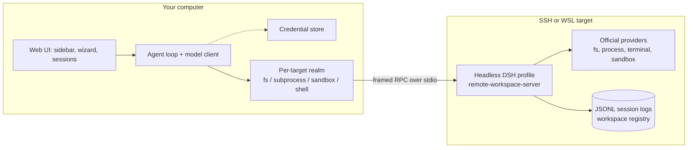

# dsh-remote-workspace

English | [中文](README-zh.md)

[](LICENSE)
[](package.json)
[](#compatibility)
[](https://www.npmjs.com/package/dsh-remote-workspace)

Open an SSH host as a DeepSeek Harness workspace. The agent loop, model calls and credentials stay on
your computer; the files, the commands and the session logs live on the remote machine, so another
computer can pick the same workspace up without copying a session directory.

## Screenshots


The sidebar section groups a connection, its workspaces and their sessions; the composer shows the
remote preset and the workspace-scoped permission mode. Nothing in this view is a local path — the
session and its log live on the target.

## Why this exists

Harness works on the machine that runs it. When the work has to happen somewhere else — a build box, a
GPU host, a staging server — there are three options, and only the third one keeps the session intact:

1. **Copy the files back.** A mirror drifts, conflicts, and quietly breaks the moment two people touch
   the same tree.
2. **Run the agent on the remote.** Then the model credentials and the conversation live there too, and
   every machine needs its own install.
3. **Keep the agent here and the world there.** That is this plugin: a headless DSH profile runs on the
   target, and the client speaks a framed RPC protocol to it over SSH (or WSL) stdio.

Three invariants follow from that split, and they are the reason the code is shaped the way it is:

- **Credentials never cross the line.** Model keys and SSH secrets stay in the local credential store;
  errors, logs and streamed details are scrubbed before they are shown.
- **The target listens on nothing.** There is no port to expose: the server half is a child process on
  the SSH channel's stdio.
- **One server process per target.** Browsing and agent work share one channel, which is what keeps a
  single session writer and a single workspace registry authoritative.

If you only need "edit files on one server", stop here and use the official SSH profile
(`dsh-ssh` + `fs-ssh` + `subprocess-ssh` + `sandbox-ssh`): it is smaller and it needs no plugin.

## How it compares

| | Official SSH profile | File-routing plugins | This plugin |
| --- | --- | --- | --- |
| Where tools execute | remote | remote | remote |
| Several targets in one UI | one profile per host | yes | yes |
| Session logs | local | local | **remote, server-authoritative** |
| Sandbox | remote provider | host-side policy | **remote provider + policy** |
| Continuation from another computer | no | no | **yes** |

The distinguishing question is not "does it run remotely" — it does in all three columns. It is whether
the session log and the workspace registry are authoritative on the target, which is what makes several
clients and several days of work line up.

## Architecture



The local half owns the agent loop, the model, the credentials and the browser UI. The remote half owns
the files, the processes, the sandbox backend and the authoritative session log. Each target gets its own
isolate realm, so two targets cannot share a session world by accident; if the realm fails to mount, the
session refuses to run instead of silently executing locally. The wire protocol is described in
[doc/architecture.md](doc/architecture.md) and [doc/api-contract.md](doc/api-contract.md).

## Feature breakdown

**Remote execution world.** DSH's own filesystem, process, terminal and sandbox providers are pointed at
the target through one `ctx.ssh` adapter. The `read` / `write` / `edit` / `glob` / `grep` tools and the
`bash` tool therefore act on the remote tree with no mirror and no special-purpose tools to learn.

**Server-authoritative sessions.** New, open, resume, rename, fork, pin and archive all read and write the
JSONL log on the target. Renaming appends a `session/title` event without opening the session; forking
uses the shell's own fork and keeps the inherited event metadata; pin and archive store view state
locally and never rewrite the log.

**Three ways to get a runtime.** Probe the target read-only, then *reuse* an installed `dsh` whose version
is verified, *upload* a package built here for the target's OS and CPU, or *download* the published
package for that architecture and verify its checksum before uploading. Only one server process is
started per target.

**Host keys are pinned.** The first connection shows the host key's SHA-256 and waits for an explicit
confirmation; a later key change stops the connection. WSL is a local process and has no host key step.

**Sandbox and permissions.** The remote profile mounts the official sandbox provider and policy, so writes
are confined to the workspace root where a backend exists. The client asks for the facts rather than
assuming them: when the target has no confinement backend the world reports partial enforcement and the
command is executed there.

**WSL.** On Windows the same plugin can open a WSL distribution as the target. The distribution drives a
POSIX world (multiline scripts go through `/bin/sh -s`), and it needs no host key confirmation.

**Several clients, one workspace.** Because the registry and the logs are remote, a second computer that
connects to the same target sees the same workspaces and can continue the same session.

## Quick start

Install into the `web` profile:

```bash
dsh plugin --profile web add dsh-remote-workspace
```

Or build from a checkout and install the tarball:

```bash
pnpm install && pnpm typecheck && pnpm test && pnpm build
pnpm pack --pack-destination ~/.dsh/tarballs
dsh plugin --profile web add ~/.dsh/tarballs/dsh-remote-workspace-<version>.tgz
```

Restart the process that serves `dsh web` and reload the page. Then:

1. Open **Remote Workspaces** in the sidebar and choose **New connection**.
2. Pick `SSH` (or `WSL` on Windows), fill in the alias and the target details, and confirm the host key
   fingerprint on first contact.
3. The wizard connects and probes the target by itself; pick a runtime from the list it finds (reuse an
   installed dsh) or choose **Deploy a new runtime** and decide whether to upload or download it. A failed
   attempt is not saved — the connection appears only after it succeeds.
4. Use the plus action on the connection row to browse the target and add a directory as a workspace.
5. Open the blank row under the workspace for a new session, or an existing row to continue one.

The agent works in the remote tree from then on. `bash` runs there, files are read and written there, and
the session log is written there.

## Compatibility

Verified against exactly this runtime:

| Plugin | Verified DSH runtime | Status |
| --- | --- | --- |
| 0.1.0-alpha.2 | 0.2.1-rc.2 | verified |
<!-- verified-runtimes -->

The declaration is a **precise version**, not a range: the manifest pins `engines.dsh` and every
`@deepseek-ai/dsh-*` peer to the runtime above, and the client accepts a remote launcher only when its
version is one of the verified runtimes. DSH is a developer preview, so an unverified release is not
promised to work — it is refused with an actionable message instead of failing halfway.

If you intentionally run another DSH version, exempt the exact pair in the profile and treat the result as
unsupported:

```bash
dsh plugin --profile web allow-version dsh-remote-workspace@<installed version> \
  --dsh-version <runtime version> --accept-risk
```

That exemption covers the plugin on the local host only. A remote launcher of another version cannot be
exempted: install the verified runtime on the target, or choose *Upload* / *Download* so the client
deploys it. Runtime packages currently cover `linux-x64-gnu`, `linux-arm64-gnu`, `darwin-x64` and
`darwin-arm64`; a Windows host reaches a POSIX world through WSL.

## Data and security

| Location | Contents |
| --- | --- |
| Target `~/.dsh/remote-server-sessions/` | Authoritative session logs |
| Target `~/.dsh/remote-server/` | Server identity, workspace registry and status manifest |
| Target `~/.dsh/server/` | Uploaded Node/DSH runtime and the deployed server bundle |
| Local DSH storage | Target records, workspace references, pin/archive view state |
| Local `~/.dsh/remote-assets/` | Verified Node and server-package cache |

Model API keys and SSH credentials stay on the local machine: the browser never receives a secret, and
every error, log line and streamed detail passes through a scrubber. HTTP routes are same-origin and
trusted-host checked with a body size limit. The credential file itself is written by DSH's credential
store (`~/.dsh/.credentials.yaml`, mode `0600`); this plugin only references records in it.

## Known limitations

- **The version coupling is deliberate.** One verified runtime per release; widening it is a release
  action backed by a deployment, not a range edit.
- **No port forwarding and no terminal panel yet.** Remote processes are reachable through `bash`; there
  is no local forward to a remote dev server, and no interactive terminal tab.
- **The remote world is POSIX.** A native Windows target is not supported; Windows reaches WSL.
- **The web profile only.** The desktop profile does not provide the browser module table and SSH
  dependencies this package uses.
- **`desktop`/`headless` profiles** are not supported targets for the UI.

## Troubleshooting

| Symptom | What to check |
| --- | --- |
| `incompatible-version` | Install DSH `0.2.1-rc.2` in the local `web` profile, or exempt that exact pair (see Compatibility). |
| No Remote Workspaces section | The plugin must be installed in `web`; restart `dsh web` and reload the page. |
| A reused launcher is rejected | The target's `dsh` is not the verified runtime — install it there, or switch to Upload/Download. |
| The first view says there are no workspaces | Wait for the server list to load, then Refresh. |
| SSH fails before provisioning | Check the account, key permissions, agent and fingerprint; `ssh -v <host>` is a good next step. |
| `unsupported remote session protocol` | Reconnect so the client redeploys the matching server bundle. |
| A command reports no usable sandbox backend | The target has no confinement backend; this is the documented partial-enforcement path. |

## Development

[AGENTS.md](AGENTS.md) holds the development contract: cross-repository byte-for-byte files, local
commands, storage and security invariants, release procedure. The roadmap and the decisions behind it are
in [doc/milestone.md](doc/milestone.md). The server half lives in
[dsh-remote-workspace-server](https://github.com/graydovee/dsh-remote-workspace-server).

## License

MIT
